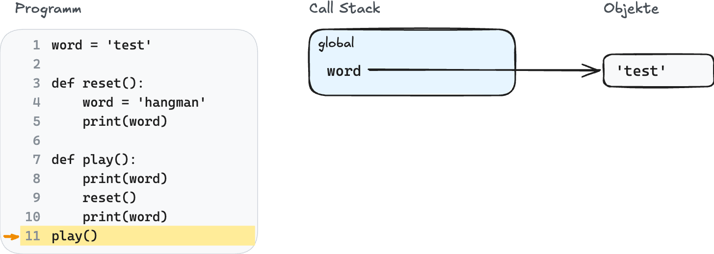
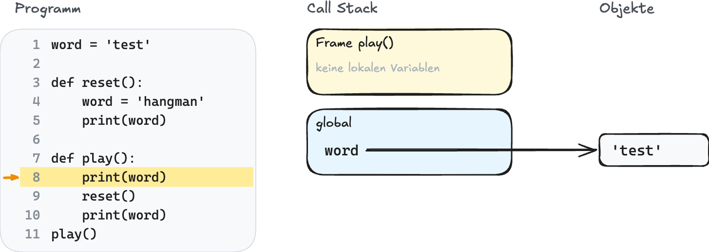
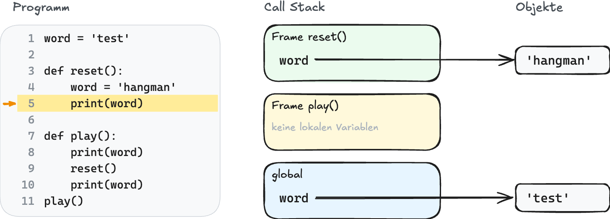
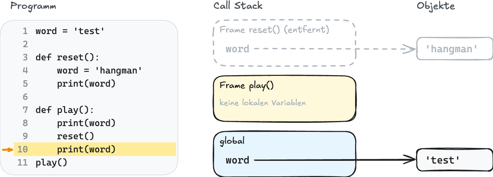

import ChoiceAnswer from '@tdev-components/documents/Assessable/ChoiceAnswer';
import Hint from '@tdev-components/documents/Assessable/Feedback/Hint';
import { points } from '@tdev-components/documents/Assessable/helpers/scoring';
import Quiz from '@tdev-components/documents/Assessable/Quiz';

# Call Stack

Im Kapitel [Scopes](../index.mdx) haben Sie gesehen, wie sich lokale und globale Variablen verhalten.

**Folgefrage:** Woher weiss Python, welches `word` gerade gemeint ist, und wieso ist eine lokale Variable nach dem Funktionsaufruf einfach weg?

:::def[Frame und Call Stack]
- Bei jedem **Funktionsaufruf** erstellt Python ein neues sogenanntes **Frame**. Darin werden die **lokalen Variablen** der Funktion gespeichert, auch die Parameter.
- Die Frames werden übereinander gestapelt: Ganz unten liegt das **globale Frame** des Hauptprogramms, ganz oben das Frame der Funktion, die gerade ausgeführt wird. Dieser Stapel heisst **Call Stack** (Aufrufstapel).
- Ist eine Funktion fertig (`return` oder Ende der Funktion), wird ihr Frame vom Call Stack **entfernt**, mit all ihren lokalen Variablen.
- Beim Lesen einer Variable sucht Python zuerst im **obersten Frame** (lokal), danach im **globalen Frame** und zuletzt bei den eingebauten Funktionen (Built-In).
  - **Achtung:** Die Frames anderer Funktionen (die zwischen dem obersten Frame und dem Built-In Frame stehen können) werden **nicht** durchsucht. Deshalb kann eine Funktion nicht auf die lokalen Variablen einer anderen Funktion zugreifen.
:::

Die Variablen in den Frames verweisen auf **Objekte**, die ausserhalb der Frames im Speicher liegen. Das kennen Sie bereits aus dem Kapitel [Referenzen](../../03-Listen/10-referenzen/index.mdx): Eine Variable ist nur ein Name, der auf ein Objekt zeigt.

## Beispiel aus der Ausgangslage

So sieht der Call Stack für das Programm aus der [Ausgangslage](../index.mdx#ausgangslage) Schritt für Schritt aus. Die gelb markierte Zeile mit dem Pfeil ist die Zeile, die als Nächstes ausgeführt wird, wie beim Debugger.

```py showLineNumbers title="Ausgangslage"
word = 'test'

def reset():
    word = 'hangman'
    print(word)

def play():
    print(word)
    reset()
    print(word)
play()
```

:::details[① Zeile 11: `play()` wird aufgerufen]


Bevor `play()` aufgerufen wird, gibt es nur das globale Frame. Darin zeigt `word` auf das Objekt `'test'`.
:::

:::details[② Zeile 8: `print(word)` in `play()`]


Der Aufruf `play()` hat ein neues Frame auf den Call Stack gelegt. `play()` hat keine lokalen Variablen. Für `word` sucht Python deshalb im globalen Frame weiter und findet `'test'`.
:::

:::details[③ Zeile 5: `print(word)` in `reset()`]


`play()` hat in Zeile 9 `reset()` aufgerufen: Ein weiteres Frame liegt jetzt zuoberst. Die Zuweisung `word = 'hangman'` in Zeile 4 hat ein **lokales** `word` im Frame von `reset()` erstellt. Python findet es im obersten Frame zuerst, deshalb wird `hangman` ausgegeben. Das globale `word` bleibt unverändert.
:::

:::details[④ Zeile 10: `print(word)` in `play()`]


`reset()` ist fertig: Ihr Frame wurde vom Call Stack entfernt, und mit ihm das lokale `word`. Auf das Objekt `'hangman'` zeigt keine Variable mehr. In `play()` findet Python wieder das globale `word` mit dem Wert `'test'`.
:::

Mit dem Call Stack lassen sich auch die Beispiele aus dem Quiz und der Präsentation erklären. Die markierte Zeile ist jeweils die entscheidende Stelle.

::::info[Lokale Variablen sind nach dem Aufruf weg]
:::flex{basis=240px}
```py {6}
def stuhl():
    pp = 99
    return pp

stuhl()
print(pp)
```
::br
**Ausgabe:** `NameError: name 'pp' is not defined`\
`pp` liegt im Frame von `stuhl()`. Nach dem Aufruf wird dieses Frame vom Call Stack entfernt, und mit ihm `pp`. Im globalen Frame gibt es kein `pp`.
:::
::::

::::info[Eine Zuweisung in der Funktion erstellt eine lokale Variable]
:::flex{basis=240px}
```py {4}
qq = 3

def fahrrad():
    qq = 7

fahrrad()
print(qq)
```
::br
**Ausgabe:** `3`\
`qq = 7` erstellt ein neues `qq` im Frame von `fahrrad()`. Das `qq` im globalen Frame wird dabei nicht verändert.
:::
::::

::::info[Lesen geht auch aus dem globalen Frame]
:::flex{basis=240px}
```py {4}
x = 55

def hallo():
    return x

print(hallo())
```
::br
**Ausgabe:** `55`\
Im Frame von `hallo()` gibt es kein `x`. Python sucht deshalb im globalen Frame weiter und findet dort `x`.
:::
::::

::::info[Listen können in einer Funktion verändert werden]
:::flex{basis=240px}
```py {2}
def umbenennen(liste):
    liste[0] = 'Melanie'

namen = ['Fred']
umbenennen(namen)
print(namen)
```
::br
**Ausgabe:** `['Melanie']`\
Der Parameter `liste` im Frame von `umbenennen()` und die globale Variable `namen` zeigen auf **dasselbe Listen-Objekt**. Die Änderung am Objekt ist deshalb auch über `namen` sichtbar.
:::
::::

::::info[Der Rückgabewert überlebt das Frame]
:::flex{basis=240px}
```py {3}
def sinnlos():
    z = 77
    return z

print(sinnlos())
```
::br
**Ausgabe:** `77`\
Nach dem `return` wird das Frame von `sinnlos()` samt `z` entfernt. Das Objekt `77` bleibt aber bestehen und wird an die aufrufende Stelle zurückgegeben.
:::
::::

## Den Call Stack im Debugger beobachten

Der Debugger in VS Code zeigt den Call Stack direkt an. Wie Sie den Debugger starten, steht im Kapitel [Listen](../../03-Listen/01-Listen-1D.mdx#debuggen). Für diese Aufgabe brauchen Sie zusätzlich zwei neue Schaltflächen:

- **Step Into** :mdi[debug-step-into]{.blue}: Springt in die Funktion hinein, die auf der aktuellen Zeile aufgerufen wird.
- **Step Out** :mdi[debug-step-out]{.blue}: Führt die aktuelle Funktion zu Ende und springt zurück zur aufrufenden Stelle.

In der Seitenleiste von **Run and Debug** sehen Sie den Bereich **Call Stack** mit allen Frames (oben das aktuelle) und den Bereich **Variables** mit den Variablen des ausgewählten Frames (**Locals**) und den globalen Variablen (**Globals**).

Im folgenden Beispiel hält der Debugger beim Programm aus der [Ausgangslage](../index.mdx#ausgangslage) auf Zeile 5 an, also in `reset()`, wie im dritten Schritt oben:

:mdi[numeric-1-circle-outline]
: Der **Call Stack** enthält drei Frames: `reset` (oben, aktuell), `play` und `<module>`. `<module>` ist das globale Frame.
:mdi[numeric-2-circle-outline]
: Unter **Locals** steht das lokale `word` aus dem Frame von `reset()`.
:mdi[numeric-3-circle-outline]
: Unter **Globals** steht das globale `word`, das unverändert `'test'` ist.
:mdi[numeric-4-circle-outline]
: Die gelb markierte Zeile wird als Nächstes ausgeführt.
:mdi[numeric-5-circle-outline]
: Hier finden Sie **Step Into** :mdi[debug-step-into]{.blue} und **Step Out** :mdi[debug-step-out]{.blue}.


Wenn Sie im Call Stack auf ein anderes Frame klicken, zeigt **Variables** dessen Variablen an:

:mdi[numeric-1-circle-outline]
: Das Frame `play` ist ausgewählt.
:mdi[numeric-2-circle-outline]
: **Locals** ist leer, denn `play()` hat keine lokalen Variablen.
:mdi[numeric-3-circle-outline]
: Die grün markierte Zeile zeigt, wo `play()` gerade wartet: beim Aufruf `reset()`. Ist `reset()` fertig, geht es dort weiter.


::::aufgabe[Call Stack im Debugger]
<Answer type="state" id="c2830ba8-e95a-4f35-b089-65ba368feb13" />

Dateiname
: __EF-Informatik/exercises/05-scopes/call_stack.py__

1. Erstellen Sie das folgende Programm in Ihrem Repository.

   ```py showLineNumbers title="call_stack.py"
   def runden(wert):
       gerundet = round(wert * 2) / 2
       return gerundet


   def schnitt(liste):
       summe = 0
       for note in liste:
           summe = summe + note
       return runden(summe / len(liste))


   def auswerten(liste):
       liste.append(6)
       resultat = schnitt(liste)
       return resultat


   noten = [4.5, 5, 3.5, 5.5]
   resultat = 0
   summe = 100
   ergebnis = auswerten(noten)
   print(noten)
   print(resultat, summe, ergebnis)
   ```
2. Setzen Sie einen Breakpoint auf **Zeile 22** und starten Sie den Debugger. Gehen Sie mit **Step Into** :mdi[debug-step-into]{.blue} Schritt für Schritt durch das Programm und beobachten Sie, wie im **Call Stack** Frames dazukommen und wieder verschwinden. Probieren Sie auch **Step Out** :mdi[debug-step-out]{.blue} aus.
3. Entfernen Sie den Breakpoint auf Zeile 22 und setzen Sie einen neuen auf **Zeile 2**. Starten Sie den Debugger neu. Sobald das Programm in `runden()` hält, beantworten Sie die folgenden Fragen.

   <Quiz scoring={points(1)} randomizeOptions keepExpanded={"correct"} resetMode='incorrect' id="21b266fa-5c9d-49a8-a510-9101a1aa3565">
     <ChoiceAnswer correct={[4]}>
       Wie viele Frames zeigt der **Call Stack** an?

       1. 1
       2. 2
       3. 3
       4. 4
       5. 5

       <Hint when={['correct']}>
         Von oben nach unten: `runden`, `schnitt`, `auswerten` und `<module>`. `<module>` ist das globale Frame des Hauptprogramms.
       </Hint>
     </ChoiceAnswer>
     <ChoiceAnswer correct={[1]}>
       Welche **lokalen** Variablen gibt es im Frame von `runden`?

       1. `wert = 4.9`
       2. `wert = 4.9` und `gerundet = 5.0`
       3. `wert = 24.5`
       4. `wert = 4.9` und `liste = [4.5, 5, 3.5, 5.5, 6]`

       <Hint when={['correct']}>
         Der Debugger hält **vor** der Ausführung von Zeile 2 an, `gerundet` existiert also noch nicht. Die Variable `liste` gehört zu anderen Frames und ist in `runden` nicht sichtbar.
       </Hint>
     </ChoiceAnswer>
     <ChoiceAnswer correct={[3]}>
       Klicken Sie im Call Stack auf das Frame `schnitt`. Welchen Wert hat `summe` dort?

       1. `0`
       2. `19.5`
       3. `24.5`
       4. `100`
       5. `4.9`
     </ChoiceAnswer>
     <ChoiceAnswer correct={[1]}>
       Klicken Sie im Call Stack auf das Frame `auswerten`. Welche **lokalen** Variablen gibt es in diesem Frame?

       1. Nur `liste`
       2. `liste` und `resultat`
       3. `liste`, `resultat` und `noten`
       4. Keine

       <Hint when={['correct']}>
         `resultat` erhält erst einen Wert, wenn `schnitt(liste)` fertig ist. Dieser Aufruf läuft aber gerade, und deshalb existiert `resultat` im Frame von `auswerten` noch nicht.
       </Hint>
     </ChoiceAnswer>
     <ChoiceAnswer correct={[1]}>
       Führen Sie das Programm mit **Continue** :mdi[step-forward]{.blue} zu Ende. Was gibt **Zeile 24** aus?

       1. `0 100 5.0`
       2. `5.0 24.5 5.0`
       3. `5.0 100 5.0`
       4. `0 100 4.9`

       <Hint when={['correct']}>
         `resultat` und `summe` in den Funktionen sind lokale Variablen. Ihre Frames wurden entfernt, die globalen Variablen haben weiterhin die Werte `0` und `100`. Nur der Rückgabewert `5.0` wurde in `ergebnis` gespeichert.
       </Hint>
     </ChoiceAnswer>
   </Quiz>

4. In Zeile `23` wird `[4.5, 5, 3.5, 5.5, 6]` ausgegeben. Die globale Liste `noten` wurde also durch die Funktion `auswerten` verändert, die globalen Variablen `resultat` und `summe` aber nicht. Erklären dieses Verhalten mit Bezug auf Frames und Objekte.

   <Answer type="text" id="132a2fee-651c-4b73-97c8-8949c3403dbe" />

5. Committen & pushen.

<Solution id="638c6ce2-7d1d-42e6-b290-0f51a3c248eb">
Beim Aufruf `auswerten(noten)` wird im Frame von `auswerten` der Parameter `liste` erstellt. `liste` zeigt auf **dasselbe Listen-Objekt** (also auf dieselbe Start-Speicheradresse) wie die globale Variable `noten`. `liste.append(6)` verändert dieses Objekt, weshalb man die Änderung auch in `noten` sieht.

`resultat = schnitt(liste)` und `summe = 0` erstellen dagegen **neue Variablen** im jeweiligen Frame (`auswerten` bzw. `schnitt`). Die gleichnamigen globalen Variablen werden dabei nicht verändert. Wenn die Funktionen fertig sind, werden ihre Frames inklusive dieser lokalen Variablen wieder entfernt.
</Solution>
::::
