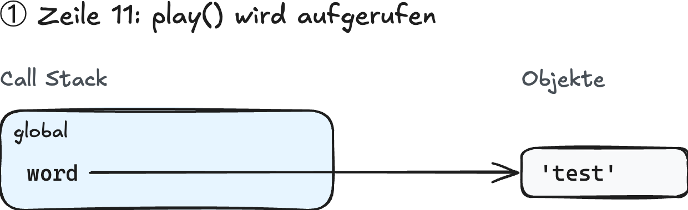
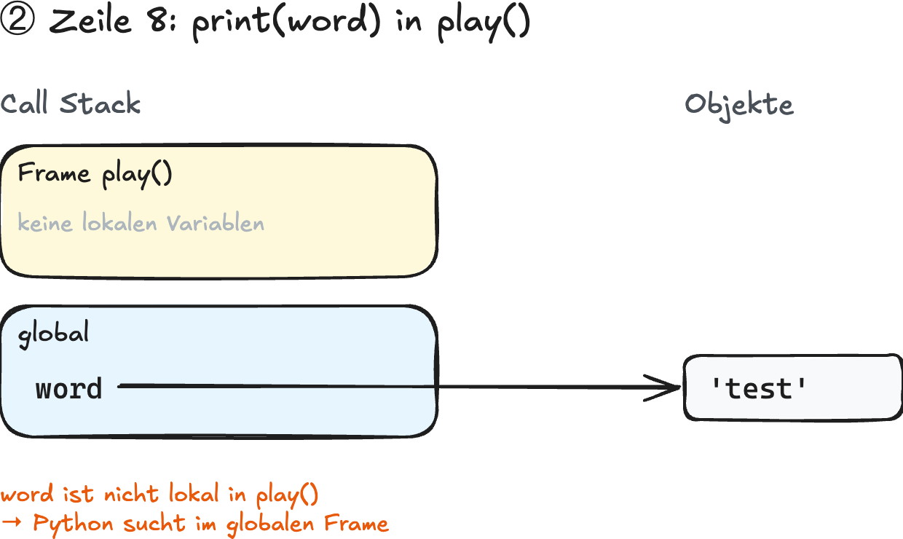
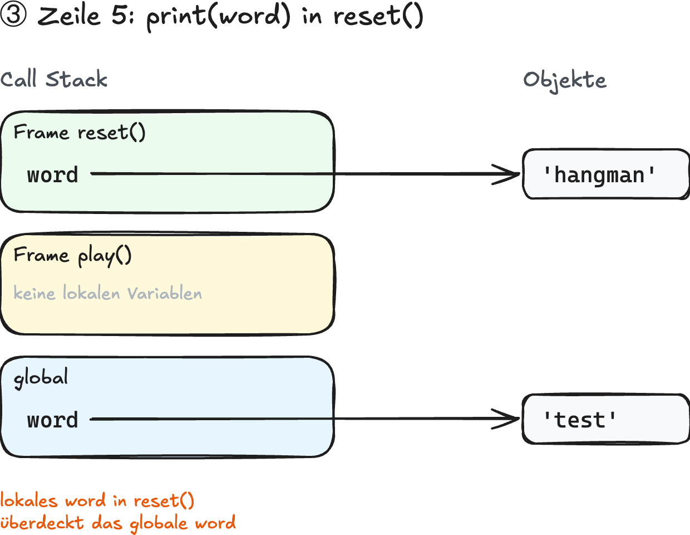
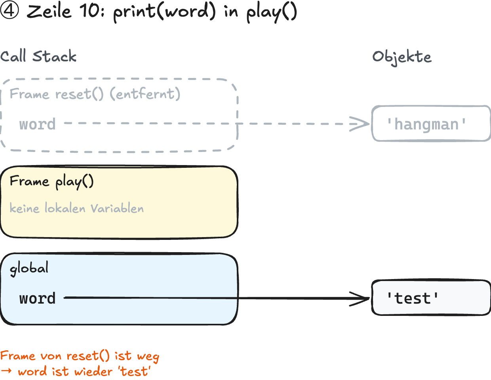

import ChoiceAnswer from '@tdev-components/documents/Assessable/ChoiceAnswer';
import Hint from '@tdev-components/documents/Assessable/Feedback/Hint';
import { points } from '@tdev-components/documents/Assessable/helpers/scoring';
import Quiz from '@tdev-components/documents/Assessable/Quiz';
import QuillV2 from '@tdev-components/documents/QuillV2';

# 4. Scopes in Python

## Ausgangslage
Wieso kann die Variable `word` auf Zeile 1 nicht verändert werden?
```py live_py slim
word = 'test'

def reset():
    word = 'hangman'
    print(word)

def play():
    print(word)
    reset()
    print(word)
play()
```

## Präsentation

<iframe src="/slides/python-scopes.html" style={{border:'0px',width:'100%',height:'500px'}} allowFullScreen="true" webkitallowfullscreen="true" mozallowfullscreen="true" />

## Notizen

<QuillV2 placeholder="✍️ Notizen..." id="3b9a5576-4d7c-4b0a-98d4-e1aac110677c" />


## Quiz

Lesen Sie in den folgenden Beispielen jeweils das Programm durch und entscheiden Sie, was ausgegeben wird.

<Quiz scoring={points(1)} randomizeQuestions randomizeOptions keepExpanded={"correct"} resetMode='incorrect' id="38d3bf30-8515-45e5-97b5-4021bbee5040">
  <ChoiceAnswer correct={[1]}>
    ```py
    x = 55

    def hallo():
        return x

    print(hallo())
    ```

    1. `55`
    2. `None`
    3. `NameError: name 'x' is not defined`
    4. `x`

    <Hint when={['correct']}>
      Die Variable `x` ist im globalen Scope definiert. Globale Variablen können überall im Programm gelesen werden, also auch im lokalen Scope einer Funktion.
    </Hint>
  </ChoiceAnswer>
  <ChoiceAnswer correct={[1]}>
    ```py
    def sinnlos():
        z = 77
        return z

    print(sinnlos())
    ```

    1. `77`
    2. `None`
    3. `NameError: name 'z' is not defined`
    4. `z`

    <Hint when={['correct']}>
      Die Variable `z` ist im lokalen Scope der Funktion `sinnlos()` definiert. Innerhalb dieser Funktion kann überall auf `z` zugegriffen werden.
    </Hint>
  </ChoiceAnswer>
  <ChoiceAnswer correct={[3]}>
    ```py
    def stuhl():
        pp = 99
        return pp

    stuhl()

    print(pp)
    ```

    1. `99`
    2. `None`
    3. `NameError: name 'pp' is not defined`
    4. Keine Ausgabe

    <Hint when={['correct']}>
      Die Variable `pp` wird in der Funktion `stuhl()` definiert. Sie hat deshalb einen lokalen Scope und kann nur innerhalb von `stuhl()` verwendet werden. Ausserhalb der Funktion existiert `pp` nicht. Der Rückgabewert von `stuhl()` wird zudem nirgends gespeichert.
    </Hint>
  </ChoiceAnswer>
  <ChoiceAnswer correct={[2]}>
    ```py
    ii = 50

    def ventilator():
        ii = 100
        return ii

    print(ventilator())
    ```

    1. `50`
    2. `100`
    3. `150`
    4. `NameError: name 'ii' is not defined`

    <Hint when={['correct']}>
      Die Variable `ii` wird zuerst im globalen Scope definiert und dann im lokalen Scope der Funktion `ventilator()` neu definiert. Gibt es eine lokale und eine globale Variable mit demselben Namen, wird innerhalb der Funktion die lokale verwendet.
    </Hint>
  </ChoiceAnswer>
  <ChoiceAnswer correct={[1]}>
    ```py
    qq = 3

    def fahrrad():
        qq = 7

    fahrrad()

    print(qq)
    ```

    1. `3`
    2. `7`
    3. `None`
    4. `NameError: name 'qq' is not defined`
    5. Keine Ausgabe

    <Hint when={['correct']}>
      Die Zuweisung `qq = 7` in `fahrrad()` erzeugt eine neue, lokale Variable `qq`, die nur innerhalb der Funktion existiert. Die globale Variable `qq` wird dabei gar nicht verändert und hat beim `print` immer noch den Wert `3`.
    </Hint>
  </ChoiceAnswer>
  <ChoiceAnswer correct={[2]}>
    ```py
    nn = 9

    if True:
        nn = 16

    print(nn)
    ```

    1. `9`
    2. `16`
    3. `NameError: name 'nn' is not defined`
    4. Keine Ausgabe

    <Hint when={['correct']}>
      `nn` erhält im globalen Scope zuerst den Wert `9` und wird dann im Codeblock des `if` auf `16` gesetzt. Anders als Funktionen erzeugen `if`-Anweisungen keinen neuen, lokalen Scope: Der Code im `if`-Block läuft im bestehenden Scope.
    </Hint>
  </ChoiceAnswer>
  <ChoiceAnswer correct={[1]}>
    ```py
    cc = 2

    if False:
        cc = 66

    def helm():
        if True:
            cc = 40

    helm()

    print(cc)
    ```

    1. `2`
    2. `66`
    3. `40`
    4. `None`
    5. `NameError: name 'cc' is not defined`

    <Hint when={['correct']}>
      `cc` erhält zuerst den Wert `2`. Die Bedingung `if False` ist nie erfüllt, deshalb wird `cc = 66` nie ausgeführt. Die Zuweisung `cc = 40` in `helm()` wird zwar ausgeführt, aber im lokalen Scope der Funktion, nicht im globalen. Im globalen Scope hat `cc` deshalb weiterhin den Wert `2`.
    </Hint>
  </ChoiceAnswer>
</Quiz>

## Scopes und der Call Stack

**Folgefrage:** Woher weiss Python, welches `word` gerade gemeint ist, und wieso ist eine lokale Variable nach dem Funktionsaufruf einfach weg?

:::def[Frame und Call Stack]
- Bei jedem **Funktionsaufruf** erstellt Python ein neues sogenanntes **Frame**. Darin werden die **lokalen Variablen** der Funktion gespeichert, auch die Parameter.
- Die Frames werden übereinander gestapelt: Ganz unten liegt das **globale Frame** des Hauptprogramms, ganz oben das Frame der Funktion, die gerade ausgeführt wird. Dieser Stapel heisst **Call Stack** (Aufrufstapel).
- Ist eine Funktion fertig (`return` oder Ende der Funktion), wird ihr Frame vom Call Stack **entfernt**, mit all ihren lokalen Variablen.
- Beim Lesen einer Variable sucht Python zuerst im **obersten Frame** (lokal), danach im **globalen Frame** und zuletzt bei den eingebauten Funktionen (Built-In).
  - **Achtung:** Die Frames anderer Funktionen (die zwischen dem obersten Frame und dem Built-In Frame stehen können) werden **nicht** durchsucht. Deshalb kann eine Funktion nicht auf die lokalen Variablen einer anderen Funktion zugreifen.
:::

Die Variablen in den Frames verweisen auf **Objekte**, die ausserhalb der Frames im Speicher liegen. Das kennen Sie bereits aus dem Kapitel [Referenzen](../03-Listen/10-referenzen/index.mdx): Eine Variable ist nur ein Name, der auf ein Objekt zeigt.

### Beispiel aus der Ausgangslage

So sieht der Call Stack für das Programm aus der [Ausgangslage](#ausgangslage) Schritt für Schritt aus:









Mit dem Call Stack lassen sich die Regeln aus der Präsentation und dem Quiz erklären:

| Beobachtung | Erklärung mit dem Call Stack |
|---|---|
| Nach dem Aufruf von `stuhl()` gibt `print(pp)` einen `NameError` | Das Frame von `stuhl()` wurde entfernt, `pp` existiert nicht mehr. |
| `fahrrad()` ändert das globale `qq` nicht | `qq = 7` erstellt eine neue Variable im Frame von `fahrrad()`. Das globale `qq` bleibt unverändert. |
| In `play()` wird das globale `word` gefunden | Im Frame von `play()` gibt es kein `word`, also sucht Python im globalen Frame weiter. |
| Eine Liste kann in einer Funktion verändert werden | Der Parameter im Frame der Funktion und die globale Variable zeigen auf **dasselbe Listen-Objekt**. |
| Der Rückgabewert bleibt nach dem Aufruf erhalten | Das Frame wird entfernt, das zurückgegebene Objekt aber nicht. |

### Den Call Stack im Debugger beobachten

Der Debugger in VS Code zeigt den Call Stack direkt an. Wie Sie den Debugger starten, steht im Kapitel [Listen](../03-Listen/01-Listen-1D.mdx#debuggen). Für diese Aufgabe brauchen Sie zusätzlich zwei neue Schaltflächen:

- **Step Into** :mdi[debug-step-into]{.blue}: Springt in die Funktion hinein, die auf der aktuellen Zeile aufgerufen wird.
- **Step Out** :mdi[debug-step-out]{.blue}: Führt die aktuelle Funktion zu Ende und springt zurück zur aufrufenden Stelle.

In der Seitenleiste von **Run and Debug** sehen Sie den Bereich **Call Stack** mit allen Frames (oben das aktuelle) und den Bereich **Variables** mit den Variablen des ausgewählten Frames (**Locals**) und den globalen Variablen (**Globals**). Wenn Sie im Call Stack auf ein anderes Frame klicken, zeigt **Variables** dessen Variablen an.

::::aufgabe[Call Stack im Debugger]
<Answer type="state" id="c2830ba8-e95a-4f35-b089-65ba368feb13" />

Dateiname
: __EF-Informatik/exercises/05-scopes/call_stack.py__

1. Erstellen Sie das folgende Programm in Ihrem Repository.

   ```py showLineNumbers title="call_stack.py"
   def runden(wert):
       gerundet = round(wert * 2) / 2
       return gerundet


   def schnitt(liste):
       summe = 0
       for note in liste:
           summe = summe + note
       return runden(summe / len(liste))


   def auswerten(liste):
       liste.append(6)
       resultat = schnitt(liste)
       return resultat


   noten = [4.5, 5, 3.5, 5.5]
   resultat = 0
   summe = 100
   ergebnis = auswerten(noten)
   print(noten)
   print(resultat, summe, ergebnis)
   ```
2. Setzen Sie einen Breakpoint auf **Zeile 22** und starten Sie den Debugger. Gehen Sie mit **Step Into** :mdi[debug-step-into]{.blue} Schritt für Schritt durch das Programm und beobachten Sie, wie im **Call Stack** Frames dazukommen und wieder verschwinden. Probieren Sie auch **Step Out** :mdi[debug-step-out]{.blue} aus.
3. Entfernen Sie den Breakpoint auf Zeile 22 und setzen Sie einen neuen auf **Zeile 2**. Starten Sie den Debugger neu. Beantworten Sie die folgenden Fragen für den Moment, in dem das Programm **zum ersten Mal auf Zeile 2 anhält**.

   <Quiz scoring={points(1)} randomizeOptions keepExpanded={"correct"} resetMode='incorrect' id="21b266fa-5c9d-49a8-a510-9101a1aa3565">
     <ChoiceAnswer correct={[4]}>
       Wie viele Frames zeigt der **Call Stack** an?

       1. 1
       2. 2
       3. 3
       4. 4
       5. 5

       <Hint when={['correct']}>
         Von oben nach unten: `runden`, `schnitt`, `auswerten` und `<module>`. `<module>` ist das globale Frame des Hauptprogramms.
       </Hint>
     </ChoiceAnswer>
     <ChoiceAnswer correct={[1]}>
       Welche Variablen zeigt **Locals** im Frame von `runden` an?

       1. `wert = 4.9`
       2. `wert = 4.9` und `gerundet = 5.0`
       3. `wert = 24.5`
       4. `wert = 4.9` und `liste = [4.5, 5, 3.5, 5.5, 6]`

       <Hint when={['correct']}>
         Der Debugger hält **vor** der Ausführung von Zeile 2 an, `gerundet` existiert also noch nicht. Die Variable `liste` gehört zu anderen Frames und ist in `runden` nicht sichtbar.
       </Hint>
     </ChoiceAnswer>
     <ChoiceAnswer correct={[3]}>
       Klicken Sie im Call Stack auf das Frame `schnitt`. Welchen Wert hat `summe` dort?

       1. `0`
       2. `19.5`
       3. `24.5`
       4. `100`
       5. `4.9`

       <Hint when={['correct']}>
         Die Schleife ist fertig: `4.5 + 5 + 3.5 + 5.5 + 6 = 24.5`. Die `6` wurde in `auswerten` an die Liste angehängt. Das globale `summe` mit dem Wert `100` ist eine andere Variable in einem anderen Frame.
       </Hint>
     </ChoiceAnswer>
     <ChoiceAnswer correct={[1]}>
       Klicken Sie im Call Stack auf das Frame `auswerten`. Welche Variablen zeigt **Locals** an?

       1. Nur `liste`
       2. `liste` und `resultat`
       3. `liste`, `resultat` und `noten`
       4. Keine

       <Hint when={['correct']}>
         `resultat` erhält erst einen Wert, wenn `schnitt(liste)` fertig ist. Dieser Aufruf läuft aber noch, deshalb existiert `resultat` im Frame von `auswerten` noch nicht. `noten` gehört zum globalen Frame.
       </Hint>
     </ChoiceAnswer>
     <ChoiceAnswer correct={[1]}>
       Führen Sie das Programm mit **Continue** zu Ende. Was gibt **Zeile 24** aus?

       1. `0 100 5.0`
       2. `5.0 24.5 5.0`
       3. `5.0 100 5.0`
       4. `0 100 4.9`

       <Hint when={['correct']}>
         `resultat` und `summe` in den Funktionen sind lokale Variablen. Ihre Frames wurden entfernt, die globalen Variablen haben weiterhin die Werte `0` und `100`. Nur der Rückgabewert `5.0` wurde in `ergebnis` gespeichert.
       </Hint>
     </ChoiceAnswer>
   </Quiz>

4. Zeile 23 gibt `[4.5, 5, 3.5, 5.5, 6]` aus: Die globale Liste `noten` wurde also durch die Funktion `auswerten` verändert, die globalen Variablen `resultat` und `summe` aber nicht. Erklären Sie mithilfe von Frames und Objekten, warum.

   <Answer type="text" id="132a2fee-651c-4b73-97c8-8949c3403dbe" />

5. Fügen Sie die Änderungen hinzu und pushen Sie sie in Ihr Repository.

<Solution id="638c6ce2-7d1d-42e6-b290-0f51a3c248eb">
Beim Aufruf `auswerten(noten)` wird im Frame von `auswerten` der Parameter `liste` erstellt. `liste` zeigt auf **dasselbe Listen-Objekt** wie die globale Variable `noten`. `liste.append(6)` verändert dieses Objekt, deshalb sieht man die Änderung auch über `noten`.

`resultat = schnitt(liste)` und `summe = 0` erstellen dagegen **neue Variablen** im jeweiligen Frame (`auswerten` bzw. `schnitt`). Die gleichnamigen globalen Variablen werden dabei nicht verändert. Wenn die Funktionen fertig sind, werden ihre Frames samt diesen lokalen Variablen entfernt.
</Solution>
::::
