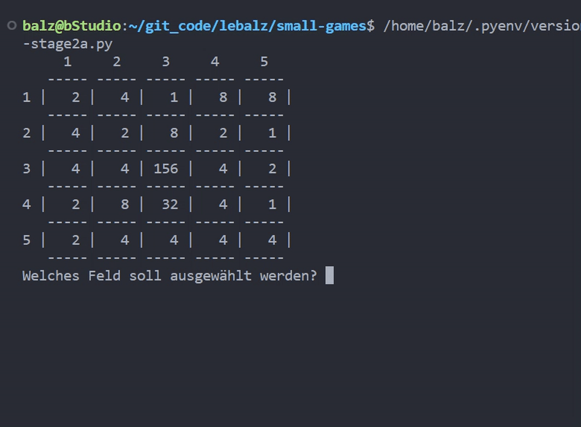

import ProgressState from '@tdev-components/documents/ProgressState';
import CodeBlock from '@theme/CodeBlock';
import Steps from '@tdev-components/Steps';

# Spielstart & Eingabe

::::note[Recap Spielfeld]
Das Spielfeld ist Voraussetzung für dieses Kapitel. Damit alle eine gute Ausgangslage haben, überprüfen Sie folgende Punkt:

<Steps>
  1. **(Für alle)**: Das Spielfeld soll wie im Beispiel unten mit einer verschachtelten Liste beschrieben werden. Die Zahlen können Sie selber wählen.
  2. **(Wer das eigene Spielfeld noch nicht fertig hat)**: Den untenstehenden Code übernehmen und Zeile für Zeile analysieren und kommentieren. Insbesondere sollte Ihnen wieder klar werden, was folgende Syntax bezweckt (sollte nach dem Kahoot klar sein :mdi[emoticon-wink-outline]{color="orange"})
     - Was macht `f'|{zelle}'` ?
     - was macht das `end=''`?
  3. &#x20;Commiten und Pushen
</Steps>

:::details[Programm]
```py live_pyo slim
board = [
    [2, 4, 1, 8, 8],
    [4, 2, 8, 2, 1],
    [4, 4, 8, 4, 2],
    [2, 8, 1, 4, 1],
    [2, 4, 4, 4, 4]
]

for zeile in board:
    for zelle in zeile:
        print(' -', end='')
    print(' ')
    for zelle in zeile:
        print(f'|{zelle}', end='')
    print('|')

for zelle in board[0]:
    print(' -', end='')
print(' ')
```
:::
::::

Nun wird's interaktiv 🥳 Eine Gamer:in soll ein Feld auswählen können.

:::flex{justify="center"}
::video[./images/numtrip-select-field-simple.mp4]{autoplay loop controls=false maxWidth="500px"}
:::

:::danger[Nur Felder auswählen]
Die Gefahr bei diesem Schritt lauert im inneren Bedürfnis, in diesem ersten Schritt bereits an alles zu Denken und das ganze Spiel zu programmieren!

:mdi[flash-triangle]{.red} in diesem Schritt **nicht gefragt** :mdi[flash-triangle]{.red}:
- :mdi[close-circle]{.red} die Eingabe auf ungültige Eingaben überprüfen
- :mdi[close-circle]{.red} ausgewählte Felder zusammenrechnen
- :mdi[close-circle]{.red} den Spielstand angebe
- :mdi[close-circle]{.red} überprüfen, ob das Spiel vorbei ist
- :mdi[close-circle]{.red} Sound hinzufügen
- :mdi[close-circle]{.red} ...
:::

::::aufgabe[Spielstart und Eingabe]

<ProgressState confirm id="6b46b4da-6561-4528-be1c-4dff38ec1b3c">

1. Die Spieler:in ein einziges Mal nach einer x- und y-Koordinate fragen. Das entsprechende Feld markieren und nicht mehr anzeigen...  
    :mdi[arrow-right] __Commit & Push__  
    :::details[Hinweis]{.orange}
    1. Zwei Eingaben, z.B. `x` und `y` abfragen
    2. Koordinaten auslesen (in Zahl umwandeln)
    3. Im Spielfeld das ausgewählte Feld markieren (bspw auf `None` oder auf `''` setzen)
    4. Aktualisiertes Spielfeld anzeigen (markiertes Feld soll leer sein)
    :::

2. Eingabe und Auswerten der Eingabe in separate Funktionen verschieben und nun diese Funktionen aufrufen...  
    :mdi[arrow-right] __Commit & Push__
3. Eine Funktion `play` o.ä. schreiben, welche solange das Spiel läuft (vorerst also unendlich lange!) den ersten Schritt wiederholt...  
    :mdi[arrow-right] __Commit & Push__  
    :::details[Hinweis]{.orange}
    Weiss man nicht im voraus, wie oft etwas wiederholt wird, so ist es immer ein Hinweis, dass eine `while` Schleife verwendet werden sollte.

    Hier eine, die unendlich lange läuft (bis man [[Ctrl]] + [[c]] drückt):

    ```py
    while True:
        eingabe()
        auswerten()
        show()
    ```
    :::

4. Code nochmals kurz durchgehen - machen Variablen- und Funktionsnamen Sinn? Könnten gewisse Dinge einfacher verständlich ($$\neq$$ weniger Code) geschrieben werden? Braucht es allenfalls irgendwo noch eine weitere Funktion?...  
    :mdi[arrow-right] __Commit & Push__
5. Erstellen Sie einen kurzes Lernjournal unter __EF-Informatik/docs/numtrip/user-input.md__
    - welcher Teil des Top-Down-Entwurfs wurde umgesetzt?
    - wie hängen die Funktionen zusammen? (vgl. Schritt 3)
    - evtl. Screenshot des Spielfeldes nach der Eingabe.
    - was kann der Code noch nicht?
    - Learnings?

    :mdi[arrow-right] __Commit & Push__  
6. ⭐ Optional: vereinfachen Sie die Userexperience [UX]
    Eingabeaufforderung akzeptiert einfacheres Format
        - zwei Zahlen, z.B. `1 2` oder `1,2` oder `1;2` oder `1-2` oder `1:2`...
        - Schachbrettnotation, z.B. `A2` oder `B3`...
        - anderes?

    
</ProgressState>
::::

{/*

:::aufgabe
<Answer type="state" id="6f414fd4-1b91-4221-95ad-514d854b0c73" />

Überprüfen Sie im NumTrip Spiel die Benutzereingaben, so dass auch bei fehlerhaften Eingaben das Programm nicht abstürzt.

:::


import skeleton2 from '!!raw-loader!./assets/skeleton-2.py';

::::info[Grundgerüst des Spiels, vol. 2]

Wichtig vor der Verwendung:
- Überlegen Sie sich, wie die untenstehende Version mit Ihrem Top-Down Entwurf zusammenpasst.
- Die Überprüfung der Eingaben muss unbedingt noch selber implementiert werden.
- Es sind aktuell keine Kommentare vorhanden - beschreiben Sie mit Kommentaren jede übernommene Funktion, was sie macht.

:::details[Grundgerüst]{.gray}
<CodeBlock language="py" showLineNumbers>
    {skeleton2}
</CodeBlock>
:::

::::
*/}